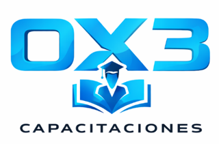
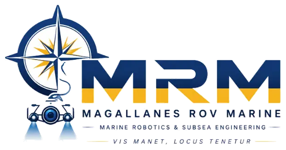
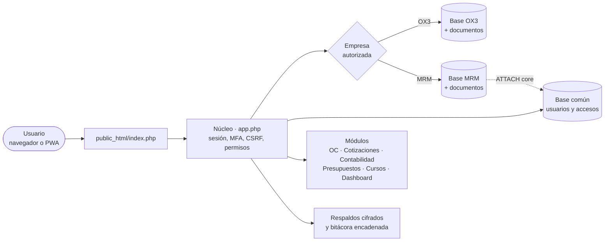
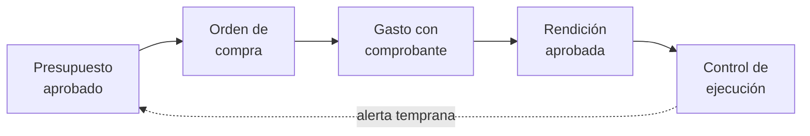

<div align="center">


&nbsp;&nbsp;&nbsp;&nbsp;


# Plataforma web multiempresa para la gestión documental, comercial y financiera de pequeñas empresas de servicios

**Caso: OX3 Capacitaciones y Magallanes ROV Marine**

Proyecto de título · Ingeniería en Computación e Informática · Universidad Gabriela Mistral (Chile)
<br>Luis Elías Vargas Vergara


[](LICENSE)

</div>

---

Plataforma web con la que dos pequeñas empresas de servicios que comparten gerencia y personal administrativo gestionan cada curso, proyecto u operación desde un solo lugar: documentos, cotizaciones, órdenes de compra, ingresos, gastos, rendiciones y presupuestos, **con los datos de cada empresa separados y trazabilidad segura**.

| | Empresa | Giro | Unidad de gestión |
| :---: | --- | --- | --- |
|  | **OX3 Capacitaciones** | Organismo técnico de capacitación | Curso |
|  | **Magallanes ROV Marine** | Inspección e ingeniería submarina con ROV | Operación o proyecto |

> [!NOTE]
> En producción como **OX3 Gestión** (`gestion.ox3.cl`). El código está organizado según el producto mínimo viable (MVP) y los incrementos definidos en la Solemne I. La documentación técnica completa está en [TECNICO.md](TECNICO.md).

## Contenido

- [Problema](#problema)
- [Hipótesis de valor](#hipótesis-de-valor)
- [Arquitectura multiempresa](#arquitectura-multiempresa)
- [MVP e incrementos](#mvp-e-incrementos)
- [Funcionalidades](#funcionalidades)
- [Requerimientos y código](#requerimientos-y-código)
- [Instalar como app](#instalar-como-app)
- [Instalación](#instalación)
- [Demostración](#demostración)
- [Procesos de prueba](#procesos-de-prueba)
- [Contexto académico](#contexto-académico)
- [Derechos de autor y uso](#derechos-de-autor-y-uso)

## Problema

> OX3 y MRM no cuentan con un mecanismo común y seguro para registrar, vincular y consultar la información documental, comercial y financiera de cada curso, proyecto u operación, con los datos de cada empresa separados. Como consecuencia, la información queda dispersa e incompleta, las aprobaciones no dejan trazabilidad y el resultado de cada servicio solo se conoce después de su cierre, cuando ya no es posible corregir desvíos.

| Dimensión | Situación actual | Respuesta de la plataforma |
| --- | --- | --- |
| **D1** · Dispersión | La información de un mismo servicio está repartida en soportes que no se comunican. | Registro único por servicio: documentos, cotizaciones, compras y gastos ligados al proyecto o centro de costo. |
| **D2** · Trazabilidad y seguridad | No queda constancia de quién registró, aprobó o consultó cada dato. | Roles, segundo factor, bitácora encadenada y respaldos cifrados. |
| **D3** · Separación entre empresas | Al compartir personas y equipos, la información de OX3 y MRM puede mezclarse. | Una base de datos por empresa y acceso solo a las empresas autorizadas. |
| **D4** · Oportunidad | El control económico del servicio ocurre al cierre y no durante la ejecución. | Presupuestos con control de ejecución, semáforo y alertas. |

## Hipótesis de valor

> [!IMPORTANT]
> Si cada gasto se registra una sola vez, con su comprobante, ligado al centro de costo del servicio y aprobado formalmente, y si el presupuesto aprobado se compara automáticamente con esos gastos y con las compras comprometidas, la gerencia podrá detectar los desvíos de un curso u operación **mientras está en ejecución, y no al cierre**.

**Criterio de validación:** los presupuestos aprobados muestran su ejecución durante el servicio, los indicadores de calidad de datos alcanzan sus metas y los usuarios califican la plataforma con un **SUS ≥ 68**.

## Arquitectura multiempresa

Monolito modular en PHP con un punto de entrada único y el código y los datos fuera de la raíz web.



| Principio | Cómo se implementa |
| --- | --- |
| **Usuarios comunes, datos separados** | La base común guarda usuarios, intentos de ingreso y asignaciones. Cada empresa tiene su propia base SQLite, carpeta de documentos, correlativos, configuración y bitácora. |
| **Selección de empresa** | Cada usuario ve solo las empresas autorizadas; los administradores ven todas. Se abre únicamente la base de la empresa elegida. |
| **Contexto protegido** | Cada formulario lleva la empresa en que se abrió; si el usuario cambió de empresa en otra pestaña, la operación se rechaza. |
| **Identidad por empresa** | Logos, datos de emisor y numeración de cotizaciones, órdenes de compra y proformas cambian según la empresa activa. |
| **Extensible** | Agregar una empresa consiste en declararla en `empresas()` (`private/app.php`); su base se crea con el mismo esquema al primer uso. |

## MVP e incrementos

El MVP reúne los requerimientos de prioridad **Debe**: lo mínimo para cerrar el ciclo del servicio, con seguridad y separación entre empresas desde el primer día.



| Incremento | Contenido | Requerimientos |
| --- | --- | --- |
| 🟢 **MVP** · sprints 1 y 2 | Ingreso con segundo factor, selección de empresa y roles; centros de costo; ingresos y gastos con comprobante y reparto; rendiciones con aprobación; órdenes de compra; presupuesto con control de ejecución y alertas; respaldos cifrados. | RF-03 a RF-06, RF-08 a RF-10, RF-12, RF-13 |
| 🔵 **Incremento 2** · sprint 3 | Gestión documental por proyecto, cotizaciones, dashboard, pendientes y avisos por correo, bitácora verificada. | RF-01, RF-02, RF-07, RF-11 |
| 🟣 **Incremento 3** · sprint 3 | Diseño y evaluación de cursos con cotización desde el curso; importación desde Excel; exportación CSV. | RF-14 a RF-16 |
| ⚪ Fuera del alcance | Permisos por carpeta, versionado de documentos, integración bancaria y con el SII. | — |

## Funcionalidades

| Módulo | Qué permite |
| --- | --- |
| 🏢 **Multiempresa** | Usuarios comunes con acceso por empresa; base, documentos, correlativos y bitácora propios de cada una. |
| 🔐 **Seguridad e identidad** | Roles administrador, editor y lector; verificación en dos pasos (TOTP) con códigos de recuperación; bloqueo tras cinco intentos por correo e IP; Cloudflare Turnstile opcional; CSRF, CSP estricta y sesiones seguras. |
| 💰 **Contabilidad de gestión** | Ingresos y gastos con comprobantes y reparto entre centros de costo; rendiciones Borrador → Enviada → Aprobada o Rechazada; resumen por período. |
| 📊 **Presupuestos** | Partidas por curso u operación, aprobación y versiones; control de ejecución con semáforo, compromisos de OC, retención de honorarios y punto de equilibrio. |
| 🧾 **Comercial y compras** | Cotizaciones y órdenes de compra con correlativo por empresa, estados, hoja imprimible y CSV. |
| 📁 **Gestión documental** | Proyectos, carpetas, categorías y búsqueda; vista previa en el servidor de PDF, imágenes, Word, Excel y PowerPoint, sin enviar archivos a terceros. |
| 📈 **Dashboard y avisos** | Ingresos frente a costos, distribución del gasto y comparación entre períodos; pendientes por rol y avisos por correo. |
| 🎓 **Cursos** (OX3) | Diseño y evaluación económica con escenarios y prorrateo de costos fijos; cotización desde el curso; importación desde Excel. |
| 🌊 **Proformas** (MRM) | Servicios ROV en español o inglés y en CLP, USD o EUR. Agregado después de la Solemne I. |

## Requerimientos y código

<details>
<summary><b>Trazabilidad de RF-01 a RF-16 a los archivos de <code>private/</code></b></summary>

<br>

| ID | Requerimiento | Prioridad | Incremento | Archivos |
| --- | --- | :---: | :---: | --- |
| RF-01 | Gestionar proyectos, carpetas y documentos con categorías, búsqueda y vista previa | Debería | 2 | `app.php`, `view.php`, `office.php` |
| RF-02 | Emitir cotizaciones con correlativo por empresa, estado, vencimiento e impresión | Debería | 2 | `cot.php`, `cot_view.php`, `intl.php` |
| RF-03 | Emitir órdenes de compra con correlativo por empresa, estados e impresión | Debe | MVP | `oc.php`, `oc_view.php` |
| RF-04 | Registrar ingresos y gastos con comprobante y reparto entre centros de costo | Debe | MVP | `contable.php`, `contable_view.php` |
| RF-05 | Rendir fondos con flujo de envío, aprobación o rechazo con motivo | Debe | MVP | `contable.php`, `contable_view.php` |
| RF-06 | Elaborar presupuestos por curso u operación, aprobarlos y controlar su ejecución con alertas | Debe | MVP | `presupuesto.php`, `presupuesto_view.php` |
| RF-07 | Consultar indicadores, pendientes por rol y recibir avisos por correo | Debería | 2 | `dash.php`, `dash_view.php`, `notify.php`, `cron.php` |
| RF-08 | Elegir empresa al ingresar y operar solo en las autorizadas | Debe | MVP | `app.php` (`empresas()`, `userEmpresas()`) |
| RF-09 | Administrar usuarios, roles y acceso a cada empresa | Debe | MVP | `app.php`, `view.php` |
| RF-10 | Ingresar con contraseña y verificación en dos pasos | Debe | MVP | `app.php`, `security.php`, `account.php`, `qr.php` |
| RF-11 | Registrar las acciones en una bitácora y verificar su integridad | Debería | 2 | `security.php`, `cron.php` |
| RF-12 | Crear, verificar y restaurar respaldos cifrados | Debe | MVP | `backup.php`, `respaldo.php` |
| RF-13 | Administrar centros de costo sin perder su historial | Debe | MVP | `contable.php` |
| RF-14 | Exportar listados a CSV | Podría | 3 | `oc.php`, `cot.php`, `contable.php` |
| RF-15 | Diseñar y evaluar económicamente cursos y cotizarlos desde la evaluación | Debería | 3 | `cursos.php`, `cursos_view.php` |
| RF-16 | Cargar cursos desde una planilla Excel con revisión de errores | Podría | 3 | `cursos_xlsx.php` |

</details>

## Instalar como app

La plataforma es una **app web progresiva (PWA)**: incluye un manifiesto (`public_html/manifest.webmanifest`) e íconos, así que el navegador permite instalarla.

| Dispositivo | Cómo instalar |
| --- | --- |
| 💻 Computador (Chrome o Edge) | Botón **Instalar** en la barra de direcciones. |
| 🤖 Android (Chrome) | Menú ⋮ → **Instalar aplicación**. |
| 🍎 iPhone (Safari) | Compartir → **Agregar a inicio**. |

Se abre en su propia ventana, con el ícono de OX3 y sin la barra del navegador. No usa JavaScript propio ni service worker, por lo que mantiene intacta la CSP estricta (la única excepción es el script de Cloudflare Turnstile en la pantalla de ingreso, si se activa), y requiere conexión porque los datos viven en el servidor. Cubre la exclusión de una aplicación móvil nativa (Tabla 2.3) sin desarrollar una aparte.

## Instalación

**Requisitos:** PHP 8.1 o superior (recomendado 8.3) con `pdo_sqlite`, `sqlite3`, `fileinfo`, `zip`, `sodium` y `dom`.

1. Subir `public_html/` y `private/` como carpetas hermanas; la raíz web debe apuntar **solo** a `public_html/`.
2. Copiar `private/config.example.php` como `private/config.php` y definir `setup_key` (32 caracteres o más), `app_url`, el correo SMTP y `backup_key`.
3. Abrir la plataforma, crear el administrador inicial con la clave de instalación y activar el segundo factor.
4. Programar `php private/cron.php` y hacer una prueba de respaldo y restauración.

**Desarrollo local**

```sh
cp private/config.example.php private/config.php
php -S 127.0.0.1:8080 -t public_html
```

En `private/config.php` local usar `https_only => false`, `app_url => 'http://127.0.0.1:8080/'`, una `setup_key` propia y `smtp_host` vacío, para que la copia local no redirija al dominio de producción ni envíe correos reales.

Para ver la plataforma con datos sin instalar nada, usar la [demostración](#demostración).

**Estructura**

```
public_html/   Raíz web: index.php, manifiesto PWA, estilos, logos e íconos
private/       Código de la aplicación, configuración y datos (fuera de la raíz web)
demo/          Demostración local con datos ficticios
TECNICO.md     Documentación técnica
```

> [!WARNING]
> Este repositorio es público. `config.php`, `app.key`, las bases `*.sqlite`, `private/empresas/`, `uploads/`, `backups/` y `audit.anchor` están excluidos en `.gitignore`: nunca subir credenciales, claves ni datos reales.

## Demostración

Una copia local con datos **ficticios** de OX3 y MRM para mostrar la plataforma completa en minutos. Requiere PHP 8.1 o superior con las extensiones de la [instalación](#instalación).

```sh
./demo/levantar.sh             # crea la demo (la primera vez) y la abre en http://127.0.0.1:8080
./demo/levantar.sh --reiniciar # borra la demo y vuelve a los datos iniciales
PORT=8090 ./demo/levantar.sh   # usa otro puerto
```

**Cómo funciona.** `demo/levantar.sh` copia `public_html/` y `private/` a `demo/.run/` (ignorada por git), crea ahí su propio `config.php` local (sin HTTPS forzado, sin correo, sin segundo factor y con claves aleatorias) y ejecuta `demo/seed.php` para cada empresa. No lee ni modifica `private/config.php` ni datos reales. Se detiene con `Ctrl+C`.

**Usuarios de prueba** (contraseña `Demo-Gestion-2026`, válida solo en la demo):

| Usuario | Rol | Qué permite mostrar |
| --- | --- | --- |
| `admin@demo.test` | Administrador | Todo: ambas empresas, usuarios, bitácora, seguridad, respaldos y aprobaciones. |
| `editor@demo.test` | Editor | Registrar y editar documentos, movimientos, rendiciones, OC y cotizaciones. |
| `lector@demo.test` | Lector | Solo consulta: los botones de crear y editar no aparecen. |

**Datos que trae** (fechas relativas al día en que se crea la demo):

| Módulo | OX3 Capacitaciones | Magallanes ROV Marine |
| --- | --- | --- |
| Proyectos y documentos | 3 proyectos; carpetas *Contrato y cotización*, *Registros* e *Informe final*; PDF, CSV y TXT con vista previa | Igual, con plan de inspección, bitácora de inmersión e informe técnico |
| Centros de costo | C-101, C-102 y ADM | P-201, P-202 y ADM |
| Cotizaciones | Aceptada, Enviada (con descuento) y Borrador | Igual, con IVA |
| Órdenes de compra | Emitida, Recibida y Borrador | Igual |
| Contabilidad | 3 ingresos y 5 gastos repartidos por centro | Igual |
| Rendiciones | Aprobada, Enviada (pendiente de aprobar) y Borrador | Igual |
| Presupuestos | Uno **aprobado** con ejecución real y **alerta de sobregiro**, y otro **por aprobar** | Igual, por operación |
| Cursos | 2 cursos con módulos, costos y evaluación económica | — |
| Proformas | — | 1 proforma en inglés y USD con anticipo |

## Procesos de prueba

Pruebas manuales sobre la demostración. Cada una indica el rol con que se hace y el resultado esperado; repetirlas tras `./demo/levantar.sh --reiniciar` para partir siempre de los mismos datos.

**Ingreso, empresas y roles**

| # | Rol | Pasos | Resultado esperado |
| --- | --- | --- | --- |
| P-01 | Administrador | Ingresar con correo y contraseña. | Aparece el selector con OX3 y MRM. |
| P-02 | Administrador | Entrar a OX3, luego *Cambiar de empresa* → MRM. | Cambian logo, datos y numeración; los datos de una empresa no se ven en la otra. |
| P-03 | Cualquiera | Ingresar 5 veces con una contraseña errada. | El ingreso se bloquea temporalmente. |
| P-04 | Lector | Recorrer Documentos, Cotizaciones, OC y Contabilidad. | Puede consultar, pero no ve los botones de crear, editar ni aprobar. |
| P-05 | Administrador | *Mi cuenta* → activar verificación en dos pasos con una app TOTP. | Pide el código en el siguiente ingreso y entrega códigos de recuperación. |

**Módulos**

| # | Módulo (RF) | Rol | Pasos | Resultado esperado |
| --- | --- | --- | --- | --- |
| P-06 | Documentos (RF-01) | Editor | Abrir el primer proyecto, entrar a una carpeta, ver un PDF y un CSV; subir un archivo. | Vista previa en la plataforma; el archivo queda en la carpeta y en la búsqueda. |
| P-07 | Cotizaciones (RF-02) | Editor | Abrir la cotización Enviada, imprimirla; crear una nueva. | Hoja imprimible con datos del emisor; la nueva toma el siguiente correlativo. |
| P-08 | Órdenes de compra (RF-03) | Editor | Crear una OC para el centro C-101 y emitirla. | Correlativo propio de la empresa; aparece como compromiso en el presupuesto. |
| P-09 | Contabilidad (RF-04, RF-13) | Editor | Registrar un gasto con comprobante repartido 50/50 entre dos centros. | El resumen por centro suma cada mitad. |
| P-10 | Rendiciones (RF-05) | Editor → Administrador | Enviar la rendición en Borrador; como administrador, aprobar la Enviada o rechazarla con motivo. | Cambia de estado, queda en *Pendientes* y en la bitácora; solo las aprobadas cuentan como gasto. |
| P-11 | Presupuestos (RF-06) | Administrador | Abrir el presupuesto aprobado; aprobar el que está *Por aprobar*. | Semáforo y porcentaje de ejecución por partida; el sobregiro se marca en rojo. |
| P-12 | Dashboard y avisos (RF-07) | Administrador | Abrir Dashboard y Pendientes; filtrar por centro y por período. | Ingresos, costos y resultado cambian según el filtro; la campana muestra los pendientes. |
| P-13 | Usuarios (RF-08, RF-09) | Administrador | Crear un usuario lector solo para MRM e ingresar con él. | Entra directo a MRM sin ver OX3. |
| P-14 | Bitácora (RF-11) | Administrador | *Actividad* → verificar la bitácora. | La cadena es íntegra e incluye la carga de la demostración. |
| P-15 | Respaldos (RF-12) | Administrador | *Seguridad* → crear un respaldo y verificarlo. | Se crea un archivo cifrado que se verifica correctamente. |
| P-16 | Exportación (RF-14) | Editor | Exportar a CSV los listados de OC, cotizaciones y movimientos. | Descarga de un CSV con los registros filtrados. |
| P-17 | Cursos (RF-15, RF-16) | Editor (OX3) | Abrir un curso, cambiar participantes y ver su evaluación; cotizar desde el curso. | Recalcula costo, margen y veredicto; crea la cotización vinculada. |
| P-18 | Proformas | Editor (MRM) | Abrir la proforma en USD e imprimirla. | Hoja en inglés con anticipo y datos bancarios. |

**Verificación automática rápida** (con la demo levantada y la sesión iniciada como administrador): cada pestaña de OX3 (20) y de MRM (12) responde 200 sin mensajes de error. Fue la verificación hecha al incorporar la demostración.

## Contexto académico

| | |
| --- | --- |
| **Metodología** | Design Science Research (Peffers et al., 2007) con sprints de Scrum. |
| **Evaluación** | Pruebas funcionales y de migración, revisión OWASP Top 10, indicadores de calidad de datos y cuestionario SUS. |
| **Hitos** | Solemne I · 20-11-2026 → Entrega II, plataforma en producción y este repositorio · 23-12-2026 → Entrega final · 13-01-2027. |

## Derechos de autor y uso

© 2026 Luis Vargas Vergara. Todos los derechos reservados.

Desarrollado como proyecto de título para Ingeniería en Computación e Informática, Universidad Gabriela Mistral (Chile). Se permite consultar el código con fines académicos y de evaluación. Cualquier copia, modificación, distribución o uso comercial requiere autorización escrita del autor. Los nombres y logos de OX3 y Magallanes ROV Marine pertenecen a sus empresas y se usan como caso de estudio.

Ver [LICENSE](LICENSE).
