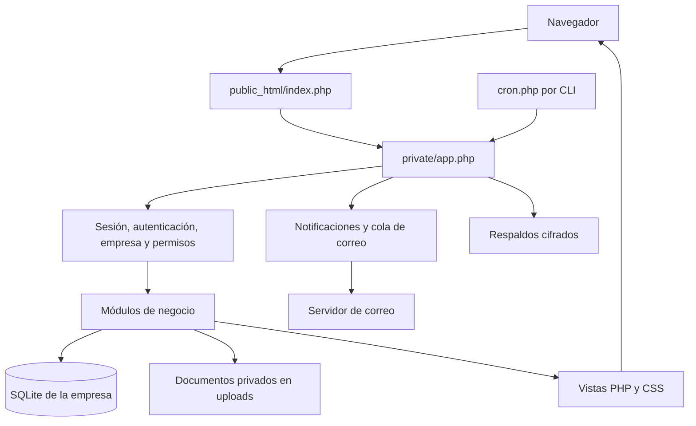

# Documentación técnica — OX3 Gestión

Fecha de revisión: 24 de octubre de 2026. Documento basado en el código del repositorio; no constituye una verificación del servidor de producción. No contiene credenciales ni datos de las bases locales.

## 1. Propósito y alcance

Aplicación web de gestión documental, comercial y contable para OX3 y MRM. Incluye proyectos y carpetas, órdenes de compra, cotizaciones, movimientos contables, rendiciones, presupuestos, indicadores, usuarios, notificaciones y respaldos cifrados.

El sistema se implementa como un monolito PHP con HTML generado en el servidor. No se observa un framework, un gestor de dependencias Composer ni una compilación de frontend en los archivos versionados. La navegación y las operaciones usan enlaces y formularios sobre `index.php`.

## 2. Arquitectura



`public_html/index.php` carga `private/app.php` mediante una ruta relativa al directorio padre. `app.php` prepara cabeceras y sesión, carga la configuración, abre SQLite, crea o adapta tablas, determina la empresa, carga módulos, procesa peticiones y finalmente incluye `view.php`.

Los módulos comparten variables y funciones globales, principalmente `$db`, `$config`, `$user`, `$canEdit`, `$isAdmin` y `$empresaKey`. La función `query()` prepara SQL y ejecuta sus parámetros con PDO.

## 3. Estructura del repositorio

| Ruta | Responsabilidad |
| --- | --- |
| `public_html/index.php` | Punto de entrada web. |
| `public_html/.htaccess` | Desactiva el listado de directorios y bloquea archivos con nombre iniciado en punto. |
| `public_html/assets/` | Hoja de estilos y logos. |
| `private/app.php` | Inicialización, autenticación, usuarios, empresas, documentos y despacho de peticiones. |
| `private/view.php` | Interfaz principal y utilidades de presentación. |
| `private/*_view.php` | Vistas de módulos. |
| `private/config.example.php` | Plantilla versionada de configuración sin secretos. |
| `private/security.php` | Claves, TOTP, recuperación y verificación de auditoría. |
| `private/notify.php` | Notificaciones internas, correo y tareas periódicas. |
| `private/backup.php` | Creación, cifrado y validación de respaldos. |
| `private/cron.php` | Ejecución programada por consola. |
| `private/respaldo.php` | Herramienta de descifrado, verificación y restauración. |
| `private/office.php` | Conversión de documentos Office a vistas HTML. |
| `private/qr.php` | Generación de códigos QR, utilizada por el enrolamiento TOTP. |
| `private/.htaccess` | Deniega acceso HTTP al directorio. |
| `private/private/` | Copia adicional de parte del código; no es la ruta cargada por el punto de entrada principal. |

Los archivos de ejecución `config.php`, `app.key`, `gestion.sqlite`, `audit.anchor`, `uploads/` y `backups/` no se publican en Git. Las empresas adicionales almacenan datos bajo `private/empresas/<clave>/`.

## 4. Requisitos de ejecución

- PHP 8.1 o superior como mínimo de sintaxis: el código utiliza tipos `never`, uniones de tipos y otras características de PHP moderno. Elegir una versión mantenida y probarla antes de desplegar.
- PDO con `pdo_sqlite`, `fileinfo`, `zip` y `sodium`; habilitar también `sqlite3`, indicada por el propio mensaje de requisitos de la aplicación.
- DOM/XML para las vistas previas Office (`DOMDocument` y `DOMXPath`).
- Soporte TLS/OpenSSL para correo seguro y conexiones HTTPS. Turnstile usa cURL si está disponible; de lo contrario, intenta acceso HTTP mediante streams.
- Permisos de escritura del usuario PHP sobre los directorios privados de datos, documentos y respaldos.
- Servidor web con raíz documental en `public_html/`. En Apache, habilitar las directivas necesarias para aplicar los `.htaccess`; en otros servidores, configurar restricciones equivalentes.
- PHP CLI para tareas programadas y recuperación desde consola.

No publicar la carpeta raíz completa como raíz web. `app.php` rechaza su ejecución HTTP si detecta que `private/` está dentro de `DOCUMENT_ROOT`.

## 5. Empresas y persistencia

`empresas()` en `private/app.php` define las empresas disponibles, logos, datos iniciales de emisor y directorios. Actualmente las claves son `ox3` y `mrm`; agregar una empresa requiere modificar esta definición.

- Base principal: `private/gestion.sqlite`, con usuarios compartidos, intentos de ingreso, asignaciones y datos de OX3.
- Base adicional: `private/empresas/mrm/gestion.sqlite`, con datos propios de MRM.
- La base adicional adjunta la principal con `ATTACH DATABASE ... AS core`.
- `GestionPDO` elimina las referencias `REFERENCES users(id)` al crear tablas en bases adicionales, porque SQLite no permite claves foráneas entre bases. Esas relaciones no tienen la misma garantía referencial que en la base principal.
- Los administradores acceden a todas las empresas; los demás usuarios, a las asignadas en `user_companies`.
- La empresa se determina mediante sesión o parámetro `emp`, comprobando los accesos permitidos. Los formularios incluyen la empresa para detectar cambios de contexto entre pestañas.

`openDb()` activa `foreign_keys` y establece `busy_timeout=5000`. Las tablas e índices se crean con `CREATE ... IF NOT EXISTS`; hay modificaciones aditivas con inspección de columnas y `ALTER TABLE`. No se observa un sistema independiente de migraciones versionadas.

### Tablas principales

| Área | Tablas |
| --- | --- |
| Identidad | `users`, `attempts`, `user_companies` |
| Documentos | `projects`, `folders`, `files` |
| Auditoría | `audit` |
| Órdenes de compra | `oc_orders`, `oc_suppliers`, `oc_settings` |
| Cotizaciones | `cot_quotes`, `cot_clients`, `cot_settings` |
| Contabilidad | `cc_centers`, `cc_rendiciones`, `cc_movs`, `cc_splits`, `cc_files`, `cc_settings` |
| Presupuestos | `ps_budgets`, `ps_lines` |
| Avisos y tareas | `notifications`, `mail_outbox`, `sys_state` |

Un movimiento puede tener varios repartos en `cc_splits` y varios comprobantes en `cc_files`. Una rendición agrupa movimientos. Un presupuesto puede asociarse a un proyecto y centro de costo, y contiene líneas en `ps_lines`.

Los importes monetarios principales se guardan como enteros y se presentan en pesos chilenos; cantidades, porcentajes y horas pueden usar valores decimales. Las fechas de negocio usan `America/Santiago`; muchos registros de creación y actualización se guardan mediante `gmdate('c')` en UTC.

## 6. Módulos funcionales

| Módulo | Archivos | Funciones principales |
| --- | --- | --- |
| Documentos | `app.php`, `view.php`, `office.php` | Proyectos, carpetas, carga, descarga y vista previa. |
| Cuenta | `account.php`, `account_view.php` | Gestión de cuenta y segundo factor. |
| Compras | `oc.php`, `oc_view.php` | Proveedores, numeración, órdenes y presentación imprimible. |
| Cotizaciones | `cot.php`, `cot_view.php` | Clientes, vigencia, totales y presentación imprimible. |
| Contabilidad | `contable.php`, `contable_view.php` | Ingresos, gastos, distribución por centros, comprobantes, rendiciones y CSV. |
| Presupuestos | `presupuesto.php`, `presupuesto_view.php` | Planificación, aprobación, ejecución, alertas y comparación con movimientos. |
| Indicadores | `dash.php`, `dash_view.php` | Filtros, comparaciones de periodos y gráficos SVG. |

Estados definidos en código:

- Órdenes: Borrador, Emitida, Aceptada, Recibida, Pagada y Anulada.
- Cotizaciones: Borrador, Enviada, Aceptada, Rechazada y Anulada. El vencimiento se evalúa por fecha.
- Rendiciones: Borrador, Enviada, Aprobada y Rechazada.
- Presupuestos: Borrador, Por aprobar, Aprobado y Cerrado.

Estas listas describen estados disponibles, no una garantía de que todas las transiciones sean válidas. Los controladores aplican permisos y restricciones adicionales.

En contabilidad, `CC_COUNTED` considera para resultados los movimientos sin rendición o con rendición aprobada. La exportación CSV genera una fila por movimiento y centro de costo: un movimiento distribuido puede producir varias filas. Para sumar distribuciones, usar el monto del centro y evitar sumar repetidamente el monto total del movimiento.

## 7. Peticiones e interfaz

La aplicación utiliza parámetros GET para seleccionar vistas y recursos, y POST con una acción para modificar datos. No se observa una API REST independiente.

Ejemplos de navegación:

```text
index.php?tab=dash
index.php?tab=cc_movs
index.php?tab=cc_rends
index.php?tab=ps
index.php?rend=123
index.php?download=123
index.php?cc_csv=1
```

Los identificadores son ilustrativos. Las rutas requieren la sesión y los permisos correspondientes. `go()` construye redirecciones HTTP 303 con parámetros permitidos después de una operación.

Los documentos se sirven a través de PHP desde el almacenamiento privado. Hay vistas previas para PDF, imágenes, texto, CSV y formatos Office modernos. La interpretación Office es propia y no equivale a ejecutar Word, Excel o PowerPoint. Las hojas imprimibles se guardan como PDF mediante la impresión del navegador.

## 8. Autenticación y seguridad implementada

- Roles: `admin`, `editor` y `viewer`. `$canEdit` habilita operaciones de edición para administradores y editores; cada módulo puede imponer condiciones de propietario o estado.
- Instalación inicial con `setup_key` de al menos 32 caracteres; la creación inicial procede cuando no existen usuarios.
- Contraseñas de entre 12 y 72 caracteres, almacenadas mediante las funciones de hashing de PHP.
- Sesión con cookies `HttpOnly`, `SameSite=Strict` y `Secure` cuando la petición se detecta como HTTPS; expiración por 30 minutos de inactividad y regeneración de identificador al ingresar.
- Token CSRF en formularios y validación del contexto de empresa.
- Limitación de intentos de autenticación y segundo factor TOTP con códigos de recuperación.
- `mfa_roles` determina los roles obligados a enrolarse en TOTP.
- `app.key` contiene la clave interna; `security.php` deriva subclaves y cifra secretos. Conservarla al migrar o restaurar datos.
- Auditoría con hashes y ancla local, verificada por las tareas periódicas. Este mecanismo detecta inconsistencias; no sustituye un registro externo independiente.
- Cabeceras CSP, `nosniff`, protección de marcos y HSTS cuando corresponde. La política se adapta para el ingreso con Turnstile y la visualización de archivos.
- Turnstile se activa únicamente cuando están configuradas ambas claves.

Esta descripción registra mecanismos presentes en el código; no es una auditoría de seguridad ni una certificación de aislamiento.

## 9. Configuración e instalación

1. Instalar el código manteniendo `public_html/` y `private/` como directorios hermanos. Ajustar la ruta en `public_html/index.php` si se cambia esta disposición.
2. Crear `private/config.php` a partir de `private/config.example.php`, únicamente si todavía no existe; no sobrescribir una configuración operativa.
3. Definir la clave de instalación y la URL del entorno. Configurar correo, Turnstile y respaldos según las funciones requeridas.
4. Verificar extensiones y permisos. PHP debe poder crear SQLite, la clave interna y los directorios de datos. Evitar permisos globales de escritura.
5. Servir exclusivamente `public_html/` y abrir la aplicación para crear el administrador inicial.
6. Completar el segundo factor cuando corresponda y asignar usuarios a las empresas.
7. Configurar cron, comprobar correo y realizar una prueba de respaldo y recuperación en un directorio separado.

| Parámetros | Uso |
| --- | --- |
| `setup_key` | Autoriza la instalación inicial. |
| `https_only` | Exige HTTPS mediante redirección. |
| `max_upload_mb`, `quota_mb` | Límites de carga y almacenamiento; la plantilla establece 20 y 12288 MB. |
| `turnstile_site_key`, `turnstile_secret_key` | Verificación del ingreso con Cloudflare. |
| `app_url` | URL utilizada para enlaces de correo. |
| `smtp_host`, `smtp_port`, `smtp_secure`, `smtp_user`, `smtp_pass` | Transporte SMTP. |
| `mail_from`, `mail_from_name` | Remitente de notificaciones. |
| `mfa_roles` | Roles obligados a usar segundo factor. |
| `backup_key`, `backup_keep`, `backup_auto_hours` | Frase de cifrado, retención e intervalo de respaldos. |

**Detalle de portabilidad:** la redirección HTTPS de `app.php` contiene un dominio fijo. Cambiar `app_url` no cambia esa redirección; adaptarla al desplegar en otro dominio o revisar el comportamiento detrás de un proxy TLS.

Para desarrollo aislado, con una configuración local y `https_only=false`:

```sh
php -S 127.0.0.1:8080 -t public_html
```

El servidor integrado es solo para desarrollo y no aplica `.htaccess`. Mantener siempre la raíz en `public_html`. Ajustar también `upload_max_filesize` y `post_max_size` de PHP a las cargas previstas.

## 10. Tareas programadas y correo

`cron.php` admite exclusivamente ejecución CLI. Recorre las empresas con base existente, procesa recordatorios, verifica auditoría y envía correo pendiente. El respaldo reúne todas las empresas.

```sh
php private/cron.php
php private/cron.php respaldo
php private/cron.php verificar
```

Ejemplo de ejecución horaria, adaptando las rutas al servidor:

```cron
0 * * * * /usr/bin/php /ruta/a/la/app/private/cron.php
```

`mail_outbox` conserva la cola, intentos y errores de envío. Sin cron, `afterResponse()` intenta ejecutar tareas al finalizar peticiones web; por ello la ejecución depende del uso de la aplicación. Configurar cron permite procesarlas sin tráfico web.

## 11. Respaldos y recuperación

Los archivos `.ox3bak` contienen un ZIP cifrado con XChaCha20-Poly1305 mediante libsodium secretstream. La clave se deriva de `backup_key` mediante Argon2id. Se exige una frase de al menos 20 caracteres.

Incluyen las bases de empresas existentes, documentos, comprobantes, anclas de auditoría, `config.php` y `app.key`. La creación emplea instantáneas SQLite, bloqueo para evitar respaldos simultáneos y retención según `backup_keep`.

```sh
php private/respaldo.php verificar /ruta/respaldo.ox3bak
php private/respaldo.php restaurar /ruta/respaldo.ox3bak /ruta/recuperacion-vacia
php private/respaldo.php descifrar /ruta/respaldo.ox3bak /ruta/salida.zip
```

La herramienta solicita la frase por teclado o la toma de `OX3_BACKUP_KEY`. La verificación necesita acceso SQLite además de ZIP y sodium. La restauración exige un destino nuevo o vacío.

Procedimiento operativo recomendado: verificar el respaldo, restaurar en una carpeta separada, revisar integridad, detener escrituras durante la sustitución de datos y comprobar acceso, MFA y documentos antes de reabrir el servicio. El ZIP descifrado contiene secretos; conservarlo fuera de Git y del directorio público. Guardar una copia del respaldo y su frase fuera del hosting, en ubicaciones protegidas.

## 12. Mantenimiento y verificación

Antes de desplegar una modificación:

1. Crear y verificar un respaldo.
2. Revisar sintaxis PHP en los archivos cambiados.
3. Probar en un entorno separado ingreso, MFA, cambio de empresa y permisos de los tres roles.
4. Probar la operación modificada y sus casos de acceso denegado.
5. Para cambios contables, comprobar importes, distribución, aprobación de rendiciones, CSV e indicadores.
6. Revisar errores PHP y cola de correo después del despliegue.

Ejemplo de comprobación de sintaxis desde la raíz:

```sh
find private public_html -name '*.php' -exec php -l {} \;
```

No se observa una suite automatizada ni configuración de integración continua en los archivos versionados revisados. En el entorno donde se redactó este documento no se encontró el ejecutable `php`; no se ejecutaron pruebas funcionales ni sintácticas de la aplicación.

## 13. Control de versiones y puntos de atención

- `.gitignore` excluye configuración privada, claves, SQLite, documentos, respaldos y archivos del sistema. Publicar código y plantillas, no los datos de operación.
- `.gitignore` no elimina un archivo que ya esté versionado: comprobar `git ls-files -ci --exclude-standard` antes de publicar.
- La carpeta `private/private/` duplica parte del código y puede generar confusión. El punto de entrada principal usa `private/app.php`; confirmar usos externos antes de eliminar la copia.
- El código referencia `INSTALACION.md`, pero ese archivo no está en la versión revisada del repositorio. Este documento describe instalación y recuperación sin modificar esas referencias.
- La configuración de empresas y algunos datos de presentación están en el código; no toda la personalización depende de `config.php`.
- El acoplamiento mediante variables globales y las modificaciones de esquema durante el arranque requieren revisar efectos entre módulos.
- La separación por empresa combina bases diferentes con usuarios comunes; probar siempre autorización y contexto de empresa cuando se agreguen consultas o descargas.
- GitHub conserva el código de la aplicación, pero no constituye un respaldo de sus datos operativos.

## 14. Referencias de implementación

- [Punto de entrada](public_html/index.php)
- [Inicialización, empresas y documentos](private/app.php)
- [Configuración de ejemplo](private/config.example.php)
- [Lógica contable](private/contable.php) y [vista contable](private/contable_view.php)
- [Presupuestos](private/presupuesto.php)
- [Seguridad](private/security.php)
- [Notificaciones](private/notify.php)
- [Respaldos](private/backup.php), [CLI de recuperación](private/respaldo.php) y [cron](private/cron.php)

## 15. Ingeniería de requerimientos

### 15.1. Propósito, fuentes y estado de la especificación

Esta sección establece una base de requisitos para mantener, validar y evolucionar la aplicación. Se obtuvo mediante ingeniería inversa del código descrito en las secciones anteriores; no reemplaza entrevistas ni aprobación de los responsables del negocio.

Convenciones:

- **Observado:** existe evidencia en el código; no significa que el requisito haya superado una prueba de ejecución.
- **Propuesto:** objetivo o control recomendado, pendiente de aprobación e implementación o medición.
- **Pendiente de validación:** decisión de negocio que no puede resolverse únicamente leyendo el código.
- **P1:** esencial para integridad, acceso o continuidad. **P2:** necesario para la operación habitual. **P3:** mejora. Las prioridades son propuestas para revisión, no compromisos aprobados.

Los identificadores `OBJ`, `RF`, `RNF`, `RN`, `CU` y `PV` permiten vincular objetivos, requisitos funcionales, requisitos no funcionales, reglas, casos de uso y decisiones pendientes. Los criterios siguientes son pruebas por ejecutar en un entorno separado con datos ficticios.

### 15.2. Problema y objetivos de negocio

Problema inferido: centralizar documentos y operaciones de varias empresas, reducir la dispersión de información y relacionar los gastos con su aprobación, centro de costo y presupuesto. La magnitud del problema y los beneficios deben confirmarse con los usuarios.

| ID | Objetivo | Evidencia esperada para aceptación de negocio |
| --- | --- | --- |
| OBJ-01 | Mantener separados los datos operativos de cada empresa y compartir la administración de usuarios. | Un usuario asignado a una empresa no obtiene datos de otra al cambiar parámetros o identificadores. |
| OBJ-02 | Centralizar documentos y operaciones comerciales consultables. | Un usuario autorizado encuentra y descarga un documento de un proyecto y consulta sus órdenes o cotizaciones. |
| OBJ-03 | Controlar ingresos, gastos y rendiciones con trazabilidad. | Una rendición enviada se revisa y sus gastos afectan resultados únicamente conforme a su aprobación. |
| OBJ-04 | Comparar presupuesto y ejecución. | Un presupuesto vinculado a un centro permite explicar los importes ejecutados con sus movimientos de origen. |
| OBJ-05 | Preservar acceso seguro y capacidad de recuperación. | Se comprueban permisos, MFA, auditoría y restauración de un respaldo en un entorno separado. |

### 15.3. Interesados y actores

| Actor o interesado | Responsabilidad o necesidad | Acceso previsto |
| --- | --- | --- |
| Responsable del negocio | Aprobar alcance, prioridades, reglas y aceptación final. | No representa un rol técnico adicional. |
| Administrador | Gestionar usuarios, empresas asignadas, configuración y revisiones. | Rol `admin`; acceso a todas las empresas definidas. |
| Editor | Registrar documentos y operaciones, preparar rendiciones y presupuestos. | Rol `editor`; empresas asignadas y restricciones por operación. |
| Lector | Consultar información autorizada sin modificar operaciones de negocio. | Rol `viewer`; empresas asignadas. Puede gestionar las opciones permitidas de su propia cuenta. |
| Responsable de rendición | Preparar y corregir gastos enviados a revisión. | Función de negocio ejercida por un usuario con permisos de edición; no es un rol independiente. |
| Operador técnico | Configurar hosting, cron, claves y recuperación. | Acceso administrativo al entorno; no implica un nuevo rol web. |
| Servicio de correo | Transportar avisos de la cola. | Integración configurada con el servidor de correo. |
| Cloudflare Turnstile | Verificar el desafío del ingreso cuando está habilitado. | Integración externa opcional. |
| Programador de tareas | Invocar mantenimiento sin tráfico web. | Ejecución CLI de `cron.php`. |

La autorización se debe comprobar en el servidor. Ocultar un botón no constituye un control de acceso.

### 15.4. Alcance y límites

**Incluido en la base actual:** autenticación y MFA, acceso por empresa, usuarios, documentos, proyectos, carpetas, órdenes, cotizaciones, contabilidad de gestión, rendiciones, presupuestos, indicadores, notificaciones, auditoría y respaldo/recuperación.

**No evidenciado como capacidad actual:** emisión tributaria electrónica ante el SII, conciliación bancaria automática, pagos bancarios, contabilidad formal de partida doble, firma electrónica, API pública, aplicación móvil nativa y sincronización con un ERP. Su incorporación requiere requisitos nuevos; no debe suponerse a partir del nombre «contabilidad».

**Restricciones:** ejecución PHP y SQLite, persistencia local privada, configuración de empresas en código y dependencia del hosting para TLS, correo y cron. El repositorio de código no almacena los datos operativos ni sustituye sus respaldos.

### 15.5. Catálogo de requisitos funcionales

Todos los requisitos de esta tabla tienen estado **Observado**. Sus criterios son una especificación de aceptación pendiente de ejecutar, no resultados de pruebas.

| ID | Requisito verificable | Actor / prioridad | Criterio de aceptación | Evidencia de implementación |
| --- | --- | --- | --- | --- |
| RF-01 | Permitir crear el administrador inicial solo cuando no existen usuarios y se presenta la clave de instalación válida. | Operador / P1 | Una clave incorrecta no crea usuarios; tras la instalación no se puede repetir el alta inicial. | `app.php`, acción `setup`. |
| RF-02 | Autenticar usuarios activos y terminar el acceso ante sesión expirada o credenciales inválidas. | Todos / P1 | Credenciales correctas permiten ingresar; credenciales incorrectas o usuario inactivo no conceden acceso. | `app.php`, autenticación y sesión. |
| RF-03 | Permitir enrolamiento TOTP y uso de códigos de recuperación, aplicando la obligatoriedad por rol. | Todos / P1 | Un rol obligado sin MFA no opera módulos antes de enrolarse; un código de recuperación usado no se acepta de nuevo. | `security.php`, `account.php`. |
| RF-04 | Administrar usuarios y asignarles acceso a empresas conforme al rol administrador. | Administrador / P1 | Un administrador asigna una empresa; un editor que envía la misma operación directamente no modifica permisos. | `app.php`, `user_companies`. |
| RF-05 | Seleccionar la empresa únicamente entre las autorizadas y utilizar su almacenamiento. | Todos / P1 | Un cambio de `emp` no autorizado no muestra ni modifica datos de la empresa solicitada. | `userEmpresas()`, `dataDir()`, selección de empresa. |
| RF-06 | Organizar documentos mediante proyectos y carpetas. | Editor y administrador / P2 | Un documento ubicado en una carpeta aparece en esa ubicación y se puede recuperar con su identificador autorizado. | `app.php`, `projects`, `folders`, `files`. |
| RF-07 | Cargar documentos aplicando validación de formato, tamaño y cuota, y servir descargas mediante la aplicación. | Usuarios según operación / P1 | Un archivo permitido dentro del límite se guarda; uno inválido o superior al límite se rechaza con un mensaje; sin sesión no se descarga. | Carga y descarga en `app.php`. |
| RF-08 | Ofrecer vista previa para los formatos soportados y descarga cuando no hay vista compatible. | Todos / P2 | PDF e imágenes se visualizan; un documento Office de prueba se interpreta sin ejecutar contenido activo. | `previewKind()`, `office.php`, `view.php`. |
| RF-09 | Crear y gestionar órdenes de compra con proveedor, numeración, importes, estado y hoja imprimible. | Editor y administrador / P2 | Una orden guardada conserva sus partidas y totales, y puede consultarse e imprimirse. | `oc.php`, `oc_view.php`. |
| RF-10 | Crear y gestionar cotizaciones con cliente, vigencia, importes, estado y hoja imprimible. | Editor y administrador / P2 | Una cotización enviada con fecha de vencimiento anterior al día actual se identifica como vencida. | `cot.php`, `cotVencida()`. |
| RF-11 | Administrar centros de costo y conservar sus referencias cuando están en uso. | Administrador / P1 | No se elimina un centro referenciado por movimientos, rendiciones o presupuestos; se puede desactivar. | Acciones `cc_center_*`. |
| RF-12 | Registrar ingresos y gastos y distribuir su importe entre centros de costo. | Editor y administrador / P1 | La suma de las distribuciones coincide con el importe; datos inválidos no dejan un movimiento parcialmente actualizado. | `ccValidateMov()`, `ccSplitsFromPost()`, `ccPost()`. |
| RF-13 | Adjuntar y consultar comprobantes de movimientos aplicando restricciones de edición. | Usuarios según operación / P1 | No se agrega ni retira un comprobante de una rendición enviada o aprobada sin cambiar antes su estado mediante una operación autorizada. | `ccSaveFiles()`, acciones de comprobantes. |
| RF-14 | Crear, corregir y enviar rendiciones con al menos un gasto. | Editor propietario y administrador / P1 | Una rendición vacía no se envía; una enviada bloquea la modificación de sus gastos. | `ccRendEditable()`, `cc_rend_send`. |
| RF-15 | Permitir al administrador aprobar, rechazar con motivo o reabrir rendiciones. | Administrador / P1 | Solo se revisa una rendición enviada; un rechazo sin motivo falla; la aprobación habilita sus gastos en resultados. | `cc_rend_review`, `cc_rend_reopen`, `CC_COUNTED`. |
| RF-16 | Consultar y exportar movimientos con filtros y distribución por centro. | Todos / P2 | Un movimiento de 10000 repartido en 6000 y 4000 genera dos filas CSV cuyo monto de centro suma 10000. | `ccMovFilter()`, `ccGetRequests()`. |
| RF-17 | Crear presupuestos con partidas, periodo y asociación a proyecto o centro. | Editor y administrador / P1 | Se rechaza un periodo invertido; un borrador válido conserva sus partidas; no se envía sin partida de gasto. | `ps_save`, `ps_send`. |
| RF-18 | Aprobar, devolver, reabrir y cerrar presupuestos conservando la referencia de la primera aprobación. | Administrador / P1 | Reabrir un aprobado incrementa la versión; una nueva aprobación mantiene los totales originales de comparación; solo se cierra un aprobado. | `ps_review`, `ps_reopen`, `ps_close`. |
| RF-19 | Calcular ejecución presupuestaria e indicadores a partir de datos vinculados y filtros. | Todos / P2 | Un conjunto conocido de movimientos produce los importes esperados para el centro y periodo seleccionados, respetando el estado de las rendiciones. | `psExec()`, `dash.php`. |
| RF-20 | Generar avisos internos y procesar correos según configuración y preferencias aplicables. | Sistema / P2 | Un evento de revisión genera el aviso correspondiente; un fallo de transporte queda registrado en la cola para su tratamiento. | `notify()`, `wfEvent()`, `mailFlush()`. |
| RF-21 | Registrar eventos auditables y verificar la integridad de la bitácora. | Sistema y administrador / P1 | Una alteración controlada en una copia de prueba es detectada por `auditVerify()`. | `security.php`, `dailyTasks()`. |
| RF-22 | Crear respaldos cifrados de las empresas y verificar y restaurar su contenido. | Administrador y operador / P1 | Un respaldo válido se restaura en un directorio vacío; clave incorrecta o respaldo truncado impiden la recuperación válida. | `backup.php`, `respaldo.php`. |
| RF-23 | Ejecutar tareas periódicas mediante CLI y limitar el acceso web a las herramientas de consola. | Operador / P2 | Cron procesa las empresas existentes; una petición HTTP a las herramientas CLI no ejecuta la operación. | `cron.php`, `respaldo.php`. |

### 15.6. Reglas de negocio

| ID | Regla observada | Requisitos relacionados |
| --- | --- | --- |
| RN-01 | El administrador accede a todas las empresas; los demás usuarios solo a las asignadas. | RF-04, RF-05 |
| RN-02 | Editar requiere rol administrador o editor, además de las restricciones particulares de cada operación. | RF-06 a RF-18 |
| RN-03 | Una rendición es editable en Borrador o Rechazada por su propietario con permiso de edición o por un administrador. | RF-13, RF-14 |
| RN-04 | Enviar una rendición requiere al menos un gasto; no se observa obligatoriedad general de adjuntar un comprobante por cada gasto. | RF-14, PV-02 |
| RN-05 | Solo el administrador revisa rendiciones enviadas; rechazar exige motivo. Puede reabrirlas a Borrador. | RF-15 |
| RN-06 | Los movimientos sin rendición y los de rendiciones aprobadas cuentan en resultados; los demás no. Reabrir una aprobada cambia esa inclusión. | RF-15, RF-19 |
| RN-07 | No se elimina un centro con referencias; se desactiva para conservar su historial. | RF-11 |
| RN-08 | El CSV tiene granularidad movimiento-centro; repetir el total del movimiento no convierte cada fila en un movimiento independiente. | RF-16 |
| RN-09 | Los presupuestos se editan en Borrador. Enviarlos requiere al menos una partida de gasto. | RF-17 |
| RN-10 | El administrador puede aprobar un presupuesto desde Borrador o Por aprobar. Devolver uno Por aprobar requiere motivo y lo deja en Borrador. | RF-18 |
| RN-11 | Reabrir un presupuesto Aprobado o Cerrado incrementa su versión; se conservan los totales de la primera aprobación, no una copia completa de cada versión. | RF-18 |
| RN-12 | Eliminar un presupuesto no modifica los movimientos contables. El editor propietario solo puede eliminarlo si es borrador y nunca fue aprobado. | RF-17, RF-18 |
| RN-13 | Las tasas y categorías configurables no equivalen a actualización tributaria automática. Su vigencia debe ser revisada por el responsable del negocio. | RF-12, RF-17, PV-06 |

### 15.7. Requisitos no funcionales y restricciones de calidad

| ID | Atributo / prioridad | Requisito y medida de aceptación | Estado / evidencia |
| --- | --- | --- | --- |
| RNF-01 | Confidencialidad / P1 | Servir documentos solo tras los controles de acceso; impedir acceso HTTP directo a configuración, claves y bases. Probar rutas directas y solicitudes sin sesión. | Observado en diseño; comprobar además la configuración real del servidor. |
| RNF-02 | Seguridad de sesión / P1 | Usar cookies protegidas, regenerar sesión al ingresar y caducar tras más de 1800 segundos de inactividad. Verificar cabeceras y expiración. | Observado: `app.php`. |
| RNF-03 | Protección de modificaciones / P1 | Rechazar formularios sin CSRF válido o con contexto de empresa discordante, sin persistir cambios. | Observado: `app.php`, `csrf()`. |
| RNF-04 | Integridad contable / P1 | Guardar movimiento y distribuciones en una transacción; ante fallo SQL revertir ambas modificaciones. La carga de adjuntos posterior debe informar fallos sin ocultar que el movimiento fue guardado. | Observado: `ccPost()`. |
| RNF-05 | Recuperabilidad / P1 | Un respaldo de prueba debe recuperar bases, documentos y claves compatibles, y superar comprobaciones de integridad. | Observado: herramientas disponibles; recuperación operativa no probada. |
| RNF-06 | Rendimiento / P2 | Establecer un límite de latencia percentil 95 para consultas y guardados con volumen y concurrencia definidos; ejecutar ensayo reproducible. No fijar un umbral sin acordar la carga. | Propuesto; depende de PV-04. |
| RNF-07 | Disponibilidad / P1 | Definir ventana de servicio, porcentaje de disponibilidad, RPO y RTO; validar mediante monitoreo y simulacro de recuperación. El intervalo de respaldo por sí solo no garantiza un RPO. | Propuesto; depende de PV-03. |
| RNF-08 | Usabilidad y accesibilidad / P2 | Completar ingreso, carga y rendición con teclado; comprobar etiquetas, foco, errores y contraste con el estándar que se acuerde. | Propuesto; no hay auditoría de accesibilidad ejecutada. |
| RNF-09 | Compatibilidad / P2 | Validar las operaciones principales y la impresión en los navegadores y versiones PHP aprobados para soporte. | Propuesto; matriz pendiente en PV-05. |
| RNF-10 | Mantenibilidad / P2 | Todo cambio de una regla debe actualizar su requisito y prueba asociada; mantener secretos y datos fuera del repositorio. | Propuesto como proceso; exclusiones Git observadas. |
| RNF-11 | Observabilidad / P2 | Registrar fallos técnicos en el servidor sin mostrarlos íntegramente al usuario; permitir revisar errores de correo y de respaldos. | Observado: manejador de excepciones, `mail_outbox`, estado de respaldos. |
| RNF-12 | Privacidad y retención / P1 | Establecer responsables, plazos de conservación y eliminación de documentos, auditoría y respaldos; comprobar la aplicación de la política aprobada. | Propuesto; la retención configurable de respaldos no cubre todos los datos. |

### 15.8. Casos de uso críticos

#### CU-01 — Ingresar y seleccionar empresa

**Actor:** usuario activo. **Precondición:** instalación completada y acceso asignado. **Requisitos:** RF-02 a RF-05.

1. El usuario introduce sus credenciales.
2. El sistema valida credenciales y aplica el segundo factor cuando corresponde.
3. El usuario selecciona una empresa autorizada, o el sistema utiliza su única empresa disponible.
4. El sistema presenta la información del contexto elegido.

**Alternativas:** credenciales inválidas, bloqueo por intentos, MFA pendiente o empresa no autorizada impiden completar el acceso operativo. **Postcondición:** la sesión identifica al usuario y la empresa permitida sin habilitar otras empresas por parámetros manipulados.

#### CU-02 — Rendir gastos y resolver su revisión

**Actores:** editor propietario y administrador. **Precondición:** empresa seleccionada y usuario autorizado. **Requisitos:** RF-12 a RF-16, RF-20, RF-21.

1. El editor crea la rendición con motivo, responsable, fecha y fondo.
2. Registra gastos, distribuciones y, cuando corresponda, comprobantes.
3. Envía la rendición; el sistema exige al menos un gasto y bloquea la edición.
4. El administrador revisa y aprueba o rechaza con motivo.
5. El sistema registra la decisión y actualiza avisos y tratamiento de los gastos en resultados.

**Alternativas:** sin gastos no se envía; sin motivo no se rechaza; un rechazo permite corregir y reenviar. **Postcondición:** la rendición conserva su estado de revisión y sus gastos cuentan en resultados únicamente si está aprobada. La reapertura administrativa constituye una operación explícita adicional.

#### CU-03 — Aprobar y controlar un presupuesto

**Actores:** editor y administrador. **Precondición:** empresa seleccionada. **Requisitos:** RF-17 a RF-19.

1. El editor registra un borrador con partidas y vinculación a centro o proyecto.
2. Envía a aprobación cuando existe al menos una partida de gasto.
3. El administrador aprueba o devuelve con motivo; también puede aprobar directamente un borrador válido.
4. El sistema compara la planificación con los movimientos aplicables al centro y periodo.
5. El administrador puede cerrar el presupuesto o reabrirlo para reformulación.

**Alternativa:** reabrir un aprobado o cerrado incrementa su versión y mantiene los totales originales como referencia. **Postcondición:** el presupuesto presenta estado, versión y ejecución coherentes, sin implicar un historial completo de todas sus versiones.

#### CU-04 — Recuperar la operación desde un respaldo

**Actor:** operador técnico. **Precondición:** respaldo disponible, frase de recuperación y entorno PHP compatible. **Requisitos:** RF-22, RNF-05.

1. El operador verifica el respaldo.
2. Restaura su contenido en un directorio nuevo o vacío.
3. Comprueba bases, documentos y disponibilidad de claves.
4. En una intervención planificada, detiene escrituras y sustituye los datos operativos.
5. Comprueba ingreso, MFA, acceso por empresa y documentos antes de reabrir el servicio.

**Alternativas:** clave incorrecta, archivo incompleto o destino no vacío detienen la recuperación correspondiente. **Postcondición:** datos recuperados y comprobados. Los pasos de puesta en servicio son un procedimiento operativo propuesto, no una restauración automática realizada por la interfaz web.

### 15.9. Datos, interfaces y dependencias

| Elemento | Requisito de tratamiento | Relación |
| --- | --- | --- |
| Identidad y credenciales | Compartir usuarios entre empresas; proteger contraseñas, secretos MFA y códigos de recuperación. | RF-02 a RF-05, RNF-01 |
| Documentos y comprobantes | Conservar asociación entre registro y archivo físico, tamaño, nombre, propietario y empresa. | RF-06, RF-07, RF-13 |
| Importes y distribuciones | Usar importes enteros en pesos donde lo define el modelo; verificar sumas y redondeos con ejemplos acordados. | RF-12, RF-16, RF-19 |
| Estados y revisiones | Conservar estado, responsable de revisión y fechas donde lo contempla el esquema. | RF-15, RF-18 |
| Correo | Configurar transporte y credenciales fuera de Git; el envío depende del proveedor y de la ejecución de tareas. | RF-20, RF-23 |
| Turnstile | Validar con el servicio externo cuando están configuradas ambas claves; comprobar el tratamiento de indisponibilidad. | RF-02, RNF-09 |
| Respaldo | Conservar datos y claves compatibles; proteger también las copias descifradas y la frase de recuperación. | RF-22, RNF-05 |

Los valores de volumen, retención y concurrencia siguen pendientes; no se han deducido capacidades máximas a partir del tamaño actual del repositorio.

### 15.10. Trazabilidad y plan de aceptación

| Objetivo | Requisitos | Casos o comprobaciones mínimas |
| --- | --- | --- |
| OBJ-01 | RF-04, RF-05; RNF-01, RNF-03 | CU-01; intentos de cambio de empresa por URL, POST y descarga con identificadores de otra empresa. |
| OBJ-02 | RF-06 a RF-10 | Crear proyecto/carpeta, cargar y recuperar archivo; rechazar formato o tamaño inválido; imprimir orden y cotización. |
| OBJ-03 | RF-11 a RF-16, RF-21; RNF-04 | CU-02; rechazo y reenvío, edición prohibida, reparto y conciliación del CSV, intento de eliminación de centro usado. |
| OBJ-04 | RF-17 a RF-19 | CU-03; periodo inválido, versión reabierta, totales originales y ejecución contra movimientos conocidos. |
| OBJ-05 | RF-01 a RF-03, RF-20 a RF-23; RNF-02, RNF-05, RNF-07 | CU-04; clave inválida, MFA, expiración, respaldo truncado, error de correo y ejecución de cron. |

Para cada prueba registrar: identificador del requisito, versión del código, entorno, rol, empresa, datos ficticios usados, pasos, resultado esperado, resultado obtenido, evidencia y defectos asociados. El estado inicial de estas pruebas es **No ejecutada**.

Criterio de cierre propuesto: todos los requisitos P1 acordados deben contar con aceptación comprobada; los defectos que permitan acceso indebido, pérdida de datos o importes incorrectos impiden aceptar la entrega. Las excepciones P2/P3 deben documentarse y aprobarse por el responsable del negocio. No considerar aprobada la especificación por el solo hecho de incluirla en el repositorio.

### 15.11. Decisiones pendientes y riesgos

| ID | Decisión pendiente | Responsable sugerido | Impacto |
| --- | --- | --- | --- |
| PV-01 | Confirmar si quien prepara una operación puede aprobarla con rol administrador o si se requiere separación de funciones. | Responsable del negocio | RF-15 y RF-18 no deben interpretarse como control de doble intervención independiente. |
| PV-02 | Definir cuándo un gasto exige comprobante, qué excepciones existen y quién las autoriza. | Responsable contable | Completar reglas de envío de rendiciones y evidencia documental. |
| PV-03 | Acordar disponibilidad, frecuencia de copias externas, RPO y RTO. | Negocio y operador | Dimensionar continuidad y simulacros de recuperación. |
| PV-04 | Acordar número de usuarios concurrentes, documentos, movimientos y tiempos de respuesta. | Negocio y equipo técnico | Evaluar SQLite, almacenamiento y rendimiento con carga representativa. |
| PV-05 | Acordar navegadores, dispositivos, versiones PHP y objetivo de accesibilidad. | Usuarios y equipo técnico | Delimitar pruebas de compatibilidad y usabilidad. |
| PV-06 | Confirmar tasas, redondeos, periodos, clasificación contable y alcance tributario esperado. | Responsable contable | Evitar tratar parámetros actuales como reglas fiscales universales. |
| PV-07 | Aprobar plazos de conservación, eliminación y acceso a datos personales y documentos. | Responsable de datos y negocio | Completar RNF-12 y procedimientos operativos. |
| PV-08 | Decidir si se exige historial íntegro de versiones presupuestarias y una auditoría externa. | Negocio y equipo técnico | La versión numérica y el ancla local no satisfacen por sí solas esos objetivos adicionales. |

Riesgos derivados: divergencia por código duplicado, indisponibilidad de servicios externos, permisos incorrectos del hosting, falta de copias fuera del servidor y cambios de esquema sin ensayos de recuperación. Su tratamiento se vincula a los requisitos de mantenibilidad, compatibilidad y continuidad; no se presupone que hayan ocurrido incidentes.

### 15.12. Gestión de cambios y validación de requisitos

1. Registrar cada solicitud con motivo, actor afectado y objetivo de negocio.
2. Vincularla a los identificadores existentes o crear uno nuevo, sin reutilizar identificadores retirados.
3. Analizar impacto en permisos, empresas, datos, estados, informes, respaldos y compatibilidad.
4. Acordar prioridad, criterio de aceptación y decisiones pendientes antes de comprometer la entrega.
5. Implementar y verificar en un entorno separado; conservar evidencias y actualizar trazabilidad.
6. Obtener la aceptación del responsable del negocio y registrar versión, fecha y excepciones.

**Estado de esta sección:** borrador técnico para revisión de negocio. No se realizaron entrevistas, pruebas funcionales ni aprobación formal durante su elaboración.
